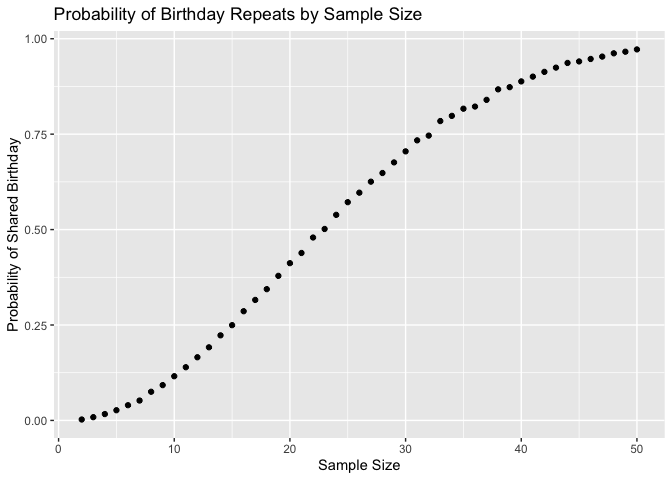
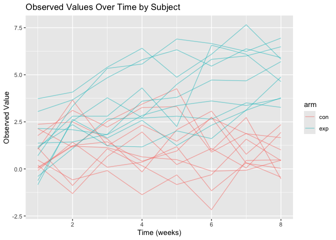

P8105 Homework 5
================
Lauren Holley

``` r
library(tidyverse)
set.seed(1)
```

## Problem 1

``` r
birthdays = function(n) {
  
  days = sample(x = 1:365, size = n, replace = TRUE)
  
  anyDuplicated(days) > 0
  
}
```

``` r
bday_results_df = 
  expand_grid(
    sample_size = 2:50,
    iter = 1:10000
  ) |> 
  mutate(
    shared_bdays = map_lgl(sample_size, birthdays)
  )
```

``` r
bday_prob_df = 
bday_results_df |> 
  group_by(sample_size) |> 
  summarize(
    shared_prob = mean(shared_bdays)
    ) 
```

``` r
bday_prob_df |> 
  ggplot(aes(x = sample_size, y = shared_prob)) + 
  geom_point() +
  labs(
    title = "Probability of Birthday Repeats by Sample Size", 
    x = "Sample Size",
    y = "Probability of Shared Birthday") 
```

<!-- -->

There is a very low probability of shared birthdays when pulling a two
person sample, and near 1 probability when pulling from a sample of 50.
I was honestly surprised by this result – I didn’t expect the
probability to be almost 100% at such a low sample size. The curve
generally follows an S shape, with the largest slope in the middle range
of the sample sizes.

## Problem 2

``` r
longit_df = 
  tibble(files = list.files("data/")) |>
  mutate(
    path = str_c("data/", files),
    data = map(path, read_csv)
  ) |>
  unnest(data) |>
  pivot_longer(
    starts_with("week_"),
    names_to = "week",
    names_prefix = "week_",
    values_to = "observed_value"
  ) |>
  mutate(subject = str_remove(files, ".csv")) |>
  separate(files, into = c("arm", "id"), sep = "_") |>
  mutate(
    id = str_remove(id, ".csv"),
    week = as.numeric(week)
  ) |>
  select(-path)
```

``` r
longit_df |>
  ggplot(aes(x = week, y = observed_value, group = subject, color = arm)) +
  geom_line(alpha = 0.5) +
  labs(
    title = "Observed Values Over Time by Subject",
    x = "Time (weeks)",
    y = "Observed Value")
```

<!-- -->

The experimental group generally displayed increasing observed values
over time compared to the control, however each group had relatively
similar baseline values. This is indicative that the experimental group
was differentially impacted by treatment as compared to the control
group.

## Problem 3

``` r
sim_mean_sd = function(n, mu = 0, sigma = 5) {
  
  sim_data = tibble(
    x = rnorm(n, mean = mu, sd = sigma),
  )
  
  sim_data |> 
    summarize(
      mu_hat = mean(x),
      sigma_hat = sd(x)
    )
}
```

``` r
output = vector("list", 5000)

for (i in 1:5000) {
  output[[i]] = sim_mean_sd(30)
}

sim_results = bind_rows(output)
```

``` r
sim_results_df = 
  expand_grid(
    sample_size = 30,
    iter = 1:5000
  ) |> 
  mutate(
    estimate_df = map(sample_size, sim_mean_sd)
  ) |> 
  unnest(estimate_df)
```
